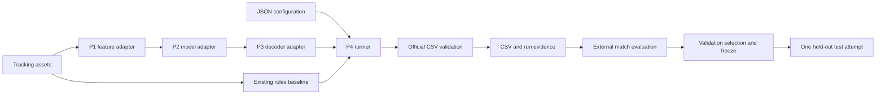

# P4 technical component

## Approach and architecture

P4 adds a dependency-light Python integration layer around the official
competition starter. It separates inference from evaluation so no ground-truth
argument enters the inference API. Configured Python adapters connect the
independently owned P1 feature, P2 neural, and P3 decoder components. File-based
feature/probability exports support incremental integration.

The runner also accepts an explicit rules/emissions adapter for P3's fallback.
No missing neural/decoder stage is silently replaced. Versioned dataclasses and
safe NPZ loading check frame alignment, period resets, missing observations,
trained feature order, and the H/A/D probability convention at every boundary.
The existing baseline uses nearest-player geometry in metres and centered
majority smoothing; it treats a missing ball as D and does not infer controlled
possession or referee stoppages. This limitation belongs to the baseline and is
not changed by integration.

## Inputs and training

P4 itself trains no model. The only real labels used during P4 implementation
are the supplied public five-minute ground truth, exclusively to verify scorer
parity, CSV handling, frame mapping, and label interpretation. They do not select
features, weights, baseline window, or decoder settings. Synthetic sequences
exercise the interfaces and failure cases. No external-match accuracy, trained
TCN, or production Viterbi result is claimed until the responsible owners supply
their actual datasets and implementations.

P1/P2 must document external datasets, annotation/label derivation, preprocessing,
training, split provenance and weights. P3 must document its actual loose-ball,
control, restart, and dead-ball rules. This component report does not substitute
for those team contributions.

## Evaluation and reproducibility

The official `possession_metrics.py` remains unchanged. Comparisons use
possession-spell F1 averaged over temporal IoU thresholds 0.3–0.7 as the primary
metric, with frame macroF1 and transition diagnostics alongside it. External
match results receive equal weight. Reports retain each match, selected split,
actual FPS, source/type of predictions, and per-match bootstrap intervals when
requested. No per-frame-independent confidence claim is made.

Independent periods and annotation runs receive internal X separators longer
than the transition tolerance; diagnostic frame indices map back to the original
timeline. At 25 fps the supplied public baseline metrics agree exactly with the
official scorer. At other FPS, transition windows and reported durations scale
to the actual clock. Group-level split declarations and explicit test freezes
reduce accidental leakage and repeated test access.

Every inference records source revision/dirty state and source content digest,
resolved configuration, environment, declared input hashes, output hash, and
elapsed/stage timing. A second inference must reproduce the CSV bytes exactly.
Source digests normalize LF/CRLF checkout differences; data, weights, and CSV
digests remain byte-exact.
Equivalent asset paths in a teammate's checkout are accepted only when input
bytes and semantic configuration match. Raw assets, derived frame-level arrays,
and submissions remain ignored local artifacts.

## Current limits and integration gates

The full supplied-match run needs restricted ATD assets, which are absent from
this checkout. Real ablations and the two consequential football-model weaknesses
need independent external validation labels and P1–P3 production outputs. Local
synthetic reproduction does not establish teammate reproduction, model quality,
or final package acceptance. The local test-attempt record is an operational
guard, not tamper-proof enforcement. See [P4_STATUS.md](P4_STATUS.md).
